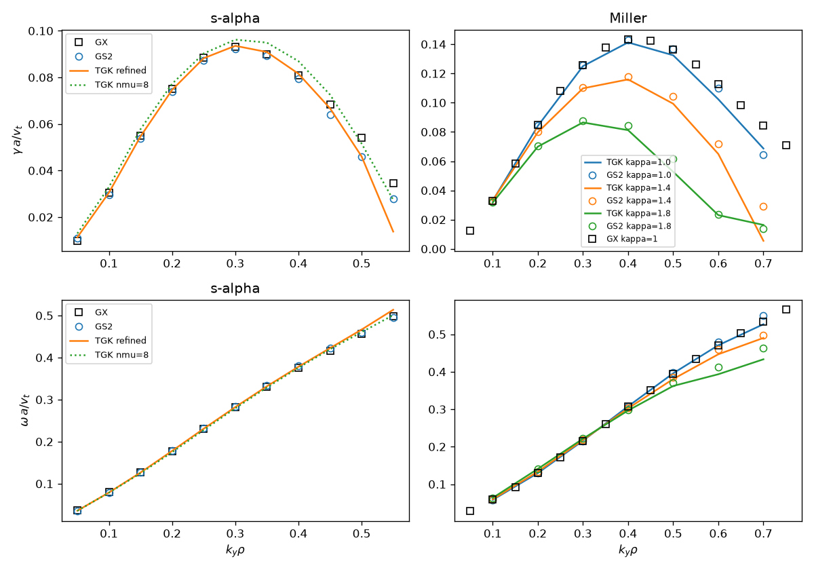
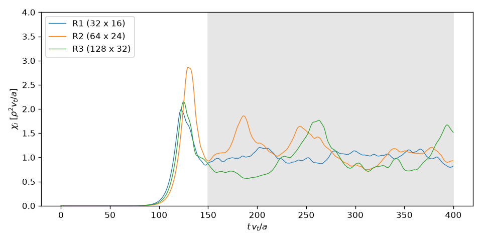

Cross-code validation
=====================

This directory compares TGK against GS2 and GX on the Cyclone Base Case
(CBC). It also checks TGK's nonlinear heat flux for convergence in
resolution. Everything here can be rerun with the scripts listed at the end.

Reference codes
---------------

- **GS2**: built from source (`make GK_SYSTEM=macosx-homebrew`) and run
  locally on the same parameters. Miller geometry comes from GS2's `eik`
  module (`bishop = 4`).
- **GX**: the reference outputs shipped in the GX repository
  (`benchmarks/linear/ITG_cyclone/*_correct.out.nc`). GX itself was not run.
  The TGK and GS2 runs use the parameters from those GX input files:
  q = 1.4, ŝ = 0.8, ε = 0.18, R/a = 2.77778, a/L_T = 2.49, a/L_n = 0.8,
  T_i = T_e.

Unit conversions
----------------

TGK and GX both use v_t = sqrt(T/m), ρ = v_t/Ω and L_ref = a. GS2 uses
v_ref = sqrt(2T/m), so

    ky_TGK = ky_GS2 / sqrt(2)
    omega_TGK = sqrt(2) * omega_GS2
    vnewk_GS2 = nu_TGK / sqrt(2)

GS2's drift coefficients are twice GX's. TGK reports ITG frequencies as
negative; the tables below flip the sign to match GX and GS2. TGK's kx has
the opposite sign to GS2's, so the geometry maps as

    gxx = gds22/ŝ²    gxy = -gds21/ŝ    gyy = gds2
    cv_y = -cvdrift/2    gb_y = -gbdrift/2    cv_x = cvdrift0/(2ŝ)

Linear growth rates are fitted over the last 40% of each run.

1. Linear s-alpha CBC, adiabatic electrons
------------------------------------------

The refined TGK runs use nz = 32, nv = 48 and nmu = 16. The default TGK
runs use nmu = 8. GS2 was run at high resolution.

| kyρ | TGK γ (nmu 8) | TGK γ (refined) | GS2 γ | GX γ | TGK ω | GS2 ω | GX ω |
|---|---|---|---|---|---|---|---|
| 0.05 | 0.0130 | 0.0113 | 0.0110 | 0.0098 | 0.0358 | 0.0353 | 0.0365 |
| 0.10 | 0.0329 | 0.0305 | 0.0295 | 0.0304 | 0.0790 | 0.0786 | 0.0798 |
| 0.15 | 0.0578 | 0.0547 | 0.0537 | 0.0550 | 0.1265 | 0.1270 | 0.1268 |
| 0.20 | 0.0773 | 0.0746 | 0.0740 | 0.0750 | 0.1780 | 0.1788 | 0.1779 |
| 0.25 | 0.0903 | 0.0882 | 0.0873 | 0.0884 | 0.2308 | 0.2319 | 0.2304 |
| 0.30 | 0.0962 | 0.0936 | 0.0922 | 0.0930 | 0.2822 | 0.2840 | 0.2820 |
| 0.35 | 0.0949 | 0.0909 | 0.0892 | 0.0898 | 0.3316 | 0.3339 | 0.3308 |
| 0.40 | 0.0870 | 0.0816 | 0.0793 | 0.0809 | 0.3782 | 0.3802 | 0.3749 |
| 0.45 | 0.0726 | 0.0667 | 0.0639 | 0.0685 | 0.4225 | 0.4218 | 0.4154 |
| 0.50 | 0.0516 | 0.0461 | 0.0458 | 0.0541 | 0.4665 | 0.4594 | 0.4559 |
| 0.55 | 0.0274 | 0.0138 | 0.0277 | 0.0346 | 0.5137 | 0.4959 | 0.4984 |

Up to kyρ = 0.45, refined TGK agrees with GS2 and GX on γ to within 2–4%
and on ω to within about 1%. The three codes are no closer to each other
than that. Near marginal stability (kyρ ≥ 0.5), all three scatter.

The default nmu = 8 overestimates γ by about 3–7%. The μ grid sets this
error: collisionless γ moves by ±4% between nmu 8 and 32, because the
discrete μ nodes resolve the drift resonance only coarsely.

2. Miller geometry and elongation
---------------------------------

The original "Miller" option in TGK was s-alpha with the drifts scaled by
1/κ. That is not Miller geometry, and it produced the destabilizing
elongation result. It has been replaced by a real local Miller equilibrium
(`geom.c`):

- Bishop's method for the radial derivatives, with F′ fixed by the shear
  constraint.
- Equal-arc θ.
- kxfac = |q ψ_ρ / r|.
- Fluxes normalized by ⟨|∇ρ|⟩.

**Geometry vs GS2 `eik`.** The table gives max|TGK − GS2| / max|GS2| along
the field line (`geomcmp.py`):

| | bmag | gds2 | gds21 | gds22 | cvdrift | gbdrift | cvdrift0 |
|---|---|---|---|---|---|---|---|
| circular | 0.04% | 0.3% | 0.3% | 0.3% | 0.5% | 0.5% | 0.4% |
| κ = 1.4, δ = 0.2 | 0.09% | 0.6% | 0.7% | 0.7% | 0.9% | 0.9% | 1.0% |

**Elongation scan.** q, ŝ and the gradients are held fixed. GS2 confirms
that elongation is stabilizing. The table gives the peak γ over ky:

| κ | TGK peak γ | GS2 peak γ | GX peak γ |
|---|---|---|---|
| 1.0 | 0.141 | 0.143 | 0.143 |
| 1.4 | 0.116 | 0.118 | – |
| 1.8 | 0.087 | 0.088 | – |

For kyρ ≤ 0.4, TGK agrees with GS2 on γ to within 1–4% at every κ (full
table in `results/tables.md`). The circular case also agrees with GX:
γ(0.3) = 0.1250 vs 0.1259.

3. Kinetic electrons, electrostatic
-----------------------------------

This uses circular Miller geometry, GX parameters, m_i/m_e = 1/2.7e-4 and
explicit RK4.

| kyρ | TGK γ | GX γ | TGK ω | GX ω |
|---|---|---|---|---|
| 0.1 | 0.0572 | 0.0347 | 0.0625 | 0.0831 |
| 0.2 | 0.1590 | 0.1585 | 0.1382 | 0.1308 |
| 0.3 | 0.2377 | 0.2300 | 0.2363 | 0.2363 |
| 0.4 | 0.2675 | 0.2646 | 0.3428 | 0.3520 |
| 0.5 | 0.2516 | 0.2539 | 0.4509 | 0.4678 |

At kyρ = 0.2–0.5, γ agrees with GX to within 3%, ω to within 6% at
kyρ = 0.2, and ω to within 4% at kyρ = 0.3–0.5.

At kyρ = 0.1 the GX reference has not converged. GX stops at t = 40, and
its instantaneous γ wanders between 0.009 and 0.054 over that time,
ending at 0.054. The time average used in the table is therefore not a
growth rate. The TGK value at kyρ = 0.1 comes from a run to t = 200, where
γ is steady to within 1e-4.

4. Electromagnetic and IMEX: not validated
------------------------------------------

The original test reported γ = 0.87 for kinetic electrons with β = 0.5% and
IMEX. That number was not physical. Two problems combined:

- **The IMEX path is wrong.** It gives γ ≈ 1.0 even at β = 0, where GX
  gives 0.23. TGK now prints a warning when `imex = 1` is used with
  kinetic electrons.
- **The explicit EM path has a spurious instability.** Fixing a factor-2
  error in the Ampère denominator exposed an instability that grows even
  with all gradients set to zero. Adding the missing A∥ mirror term
  reduced its growth from about 19 to 14 on Miller. (Flipping the sign of
  that term gave 34, which confirms the sign.) The instability persists,
  so it has not been fixed. TGK now prints a warning when `beta > 0` is
  used with kinetic electrons.

GX's KBM benchmark (β = 1.5%) gives γ = 0.206, 0.339, 0.314, 0.243 and
0.169 at kyρ = 0.1–0.5. TGK cannot reproduce it until the EM formulation is
rederived. Electromagnetic runs with adiabatic electrons are also
unvalidated.

5. Nonlinear CBC: convergence of χ_i
------------------------------------

These runs use s-alpha geometry with the GX parameters above,
adiabatic electrons, ν = 0.002, hyper_z = 0.15 and ky_min = 0.05. Each runs
to t = 400 a/v_t. Every grid has nz = 24, nv = 32 and nmu = 8. Raising
nkx and nky extends the resolved kx and ky range in a fixed box.

The heat diffusivity χ_i is in units of ρ² v_t / a. The mean is taken over
t ∈ [150, 400].

| run | nkx × nky | t_end | ⟨χ_i⟩, t ∈ [150, t_end] | standard error | ⟨χ_i⟩ [150, 275] | ⟨χ_i⟩ [275, t_end] |
|---|---|---|---|---|---|---|
| R1 | 32 × 16 | 400 | 1.014 | 0.026 | 0.988 | 1.040 |
| R2 | 64 × 24 | 400 | 1.159 | 0.082 | 1.317 | 0.995 |
| R3 | 128 × 32 | 400 | 0.974 | 0.099 | 0.980 | 0.969 |

The standard error comes from the means of 25-unit time blocks. Across
the three resolutions χ_i is 1.0–1.2, and the differences between them
lie within about 1.5 standard errors. At this level of statistics, χ_i
is converged in perpendicular resolution at about 1.0 ± 0.1.

The small grid used in `make check` (16 × 8, ŝ = 0.796) gives 1.74. That
test only checks for saturation and loose bounds.

A nonlinear GS2 comparison was not attempted. At these resolutions GS2
reached t = 3 (GS2 units) in about 20 minutes on this machine, which
extrapolates to weeks for t = 400.

6. Bugs found by this comparison
--------------------------------

1. **RK4 stages overwrote their own input.** Stages 1 and 2 wrote into the
   buffer they were still reading. The result was a spurious instability
   at the largest μ node and |kx|. It blew up every nmu = 16 run and made
   γ depend on dt. Stage buffers now ping-pong, and `make check` measures
   the convergence order (≈ 4).
2. **Miller geometry was not Miller.** It has been replaced; see section 2.
   The new radial drift `cvdrift0` was first missing a |∇r| factor, which
   was off by 90% on shaped surfaces before the GS2 comparison caught it.
3. **Ampère denominator was off by a factor of 2.** It used β Γ0 instead
   of β Σ w F0 J0² v∥².
4. **The A∥ mirror term was missing** from the gyrokinetic equation.
5. **Drifts lumped curvature and ∇B.** Shaped geometry needs them split
   (cv vs gb), and they are now separate.
6. **Hyperdiffusion acted on h, not on h/√F0.** It is now consistent with
   the streaming discretization and the free-energy diagnostic.

Reproducing
-----------

GS2, the GX repository and a Python venv (numpy, scipy, matplotlib,
netCDF4) are expected at the paths at the top of `gs2run.py` and
`report.py`.

    python scan_tgk.py; python scan_gs2_salpha.py        # section 1
    python geomcmp.py                                     # geometry
    python scan_tgk_miller.py; python scan_gs2_miller.py  # section 2
    python scan_tgk_ke.py                                 # section 3
    python nlrun.py R1 R2 R3                              # section 5 (hours)
    python report.py                                      # tables + figures

`pyshim.c`, `arnoldi.py`, `specrad.py` and `domeig.py` are diagnostic tools.
They build TGK's right-hand side as a shared library and compute the
eigenvalues of the propagator with Arnoldi iteration. They found bug 1 and
characterized the EM instability.
